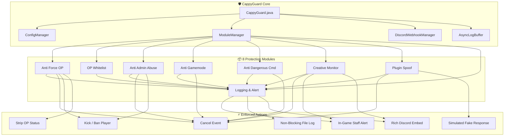

<div align="center">

# 🛡️ CappyGuard - Specification & Architecture

### High-Performance Server Security & Anti-Abuse System for Minecraft

**Protect your server against Force OP · Staff Abuse · Creative Exploits · Reconnaissance**

[](LICENSE)
[](https://papermc.io)
[](https://papermc.io)
[](https://adoptium.net)

*Developed by **Cappy Community***

</div>

---

## 📋 Table of Contents

1. [Introduction](#-introduction)
2. [Threat Vectors Addressed](#-threat-vectors-addressed)
3. [The CappyGuard Solution](#-the-cappyguard-solution)
4. [System Architecture](#-system-architecture)
5. [Detailed 8 Security Modules](#-detailed-8-security-modules)
6. [Command System](#-command-system)
7. [Granular Permission Hierarchy](#-granular-permission-hierarchy)
8. [Configuration Schema](#-configuration-schema)
9. [Development Roadmap](#-development-roadmap)
10. [Competitive Comparison](#-competitive-comparison)
11. [Technical Specifications](#-technical-specifications)

---

## 🎯 Introduction

**CappyGuard** is an all-in-one security and anti-abuse plugin developed by **Cappy Community** for modern Paper and Spigot Minecraft servers (1.21+). It establishes multiple defense layers against unauthorized privilege escalation (Force OP), administrative abuse, gamemode exploits, container theft, and server reconnaissance.

### Core Vision
> *Every Minecraft server deserves an unbreakable, zero-lag protective shield. CappyGuard delivers that defense 24/7 with zero impact on server tick rate.*

---

## 🔥 Threat Vectors Addressed

Modern Minecraft servers encounter several critical security risks:

### 1. Force OP (Privilege Escalation)
Malicious actors utilize backdoor scripts hidden inside cracked/free plugins, unpatched exploits, or compromised consoles to grant themselves operator privileges.

### 2. Staff & Admin Abuse
Staff members abusing `/give`, spamming administrative commands, griefing builds, or executing unauthorized punishment commands.

### 3. Gamemode Exploitation
Staff switching to Creative mode to harvest rare items or Spectator mode to spy on players, subsequently reverting to Survival.

### 4. Creative Item Smuggling & Container Abuse
Staff obtaining diamond, netherite, or spawners from Creative mode and depositing them into chests at secret base coordinates, storing them in Ender Chests, or dropping them to accomplice players.

### 5. Dangerous Server Commands
Destructive commands like `/stop`, `/restart`, `/reload`, `/ban`, or `/ban-ip` executed inappropriately, disrupting server availability.

### 6. Plugin Reconnaissance & Vulnerability Sniffing
Hacked clients employing automated scanner mods and tab-completion sniffing to map out the server's exact plugin list and version numbers, seeking known duplication or privilege vulnerabilities.

---

## 💡 The CappyGuard Solution

CappyGuard resolves all six threats through **8 independent, modular protection systems** operating concurrently.


### Architectural Principles
- 🧩 **Modular Design:** Every feature functions as an independent module that can be toggled and configured at runtime.
- ⚡ **Zero-Tick Impact:** $O(1)$ fast lookups with pre-parsed HashSets and EnumSets, fail-fast early returns, and async disk logging.
- 🔧 **Zero Dependency Bloat:** Employs native Paper Adventure MiniMessage and native Java 21 `HttpClient` (~62 KB compiled JAR).
- 🔒 **Multi-Layered Security:** Defense-in-depth where multiple modules reinforce each other.

---

## 🏗️ System Architecture



---

## 🔐 Detailed 8 Security Modules

### Module 1: 🚫 Anti Force OP
- **Player Command Interception:** Catches `/op` and `/minecraft:op`. Non-whitelisted players are immediately blocked.
- **Console / Backdoor Shield:** Intercepts `op <target>` executed from console or backdoor scripts. Automatically revokes OP if the target is unapproved.
- **Login Audit:** Evaluates `isOp()` on every join. If not in the whitelist, immediately strips OP and executes punishment (`DEOP`, `KICK`, `BAN`).
- **Periodic Background Scanner:** Periodically audits all online players to catch silent privilege escalations.

### Module 2: 📋 OP Whitelist
- Strict UUID and username whitelist stored in `config.yml`.
- UUID checks take precedence to prevent username change bypasses.
- Fully manageable in-game via `/cg whitelist <add|remove|list>`.

### Module 3: 🛑 Anti Admin Abuse
- **Sliding-Window Rate Limiter:** Enforces a maximum threshold of administrative commands allowed per time window.
- **Self-Give Blocker:** Restricts staff members from using `/give`, `/minecraft:give`, or `/item` commands targeting themselves.

### Module 4: 🎮 Anti Gamemode Abuse
- Intercepts `PlayerGameModeChangeEvent` to block unauthorized switches into Creative or Spectator modes.
- Supports exemptions by player UUID/username and allowed world names.

### Module 5: ⛔ Anti Dangerous Commands
- Blocks destructive server commands: `/stop`, `/restart`, `/reload`, `/ban`, `/ban-ip`, `/kick`, `/pardon`, etc.
- Granular bypass configuration for trusted server owners.

### Module 6: 📦 Creative Monitor
- **Container Placement Tracking:** Detects items deposited into Chests, Barrels, Shulker Boxes, Hoppers, or Dispensers by Creative players. Records item count, material, world name, and exact coordinates `(X, Y, Z)`.
- **Ender Chest Inspection:** Flags access to Ender Chests while in Creative mode.
- **Drop & Transfer Auditing:** Tags dropped items with dropper metadata and logs subsequent collection by other players.
- **Gamemode Switch Inspection:** Audits remaining creative items when switching to Survival, with optional `clear-on-switch` automated inventory wipe.

### Module 7: 🎭 Plugin Spoof
- **Command Interception:** Intercepts `/pl`, `/plugins`, `/bukkit:pl`, `/ver`, `/version`, `/about`, `/?`, etc.
- **Paper Native Tab Pruning:** Prunes inspection commands from the client command tree at login via `PlayerCommandSendEvent`.
- **Three Modes:**
  - `HIDE`: Standard unknown command response.
  - `FAKE`: Outputs a realistic simulated plugin list.
  - `CUSTOM_MESSAGE`: Sends a custom notification message.

### Module 8: 📝 Logging & Alert
- Thread-safe, non-blocking asynchronous file logger (`AsyncLogBuffer`).
- In-game broadcasts to staff with granular alert permissions.
- Rich Discord Embed notifications dispatching asynchronously via Java 21 `HttpClient`.

---

## 💻 Command System

Main command alias: `/cg` or `/cappyguard`.

| Command | Description | Permission |
|---|---|---|
| `/cg reload` | Reload configuration, modules, and Discord webhooks | `cappyguard.command.reload` |
| `/cg status` | Display status and statistics for all 8 modules | `cappyguard.command.status` |
| `/cg whitelist list` | View the active OP Whitelist | `cappyguard.command.whitelist` |
| `/cg whitelist add <player>` | Add an operator to the whitelist | `cappyguard.command.whitelist` |
| `/cg whitelist remove <player>` | Remove an operator from the whitelist | `cappyguard.command.whitelist` |

---

## 🔑 Granular Permission Hierarchy

### 1. Administrative Commands
| Permission | Description | Default |
|---|---|:---:|
| `cappyguard.admin` | Access to the main `/cappyguard` administration command | `op` |
| `cappyguard.command.reload` | Permission to execute `/cg reload` | `op` |
| `cappyguard.command.status` | Permission to execute `/cg status` | `op` |
| `cappyguard.command.whitelist` | Permission to manage the OP whitelist | `op` |

### 2. Monitored Staff Targets *(Applied to staff roles to enforce rules)*
| Permission | Description | Default |
|---|---|:---:|
| `cappyguard.staff` | Marks player as staff (enforces all anti-abuse rules) | `false` |
| `cappyguard.staff.creative` | Enforces Creative Monitor rules (containers, coords, drops) | `false` |
| `cappyguard.staff.gamemode` | Restricts unauthorized gamemode switching | `false` |
| `cappyguard.staff.ratelimit` | Enforces admin command rate limits | `false` |
| `cappyguard.staff.selfgive` | Blocks self-giving items using commands | `false` |
| `cappyguard.staff.commands` | Blocks dangerous server commands | `false` |

### 3. In-Game Alert Subscriptions
| Permission | Description | Default |
|---|---|:---:|
| `cappyguard.alert` | Receive all security notifications in game | `op` |
| `cappyguard.alert.forceop` | Receive Force OP notifications | `op` |
| `cappyguard.alert.creative` | Receive Creative item placement and transfer alerts | `op` |
| `cappyguard.alert.abuse` | Receive Admin Abuse and Rate Limit alerts | `op` |
| `cappyguard.alert.spoof` | Receive Plugin Scan reconnaissance alerts | `op` |

### 4. High-Level Bypass *(Server Owner Exemption)*
| Permission | Description | Default |
|---|---|:---:|
| `cappyguard.bypass.*` | Complete exemption from all security checks | `false` |
| `cappyguard.bypass.forceop` | Exempt from OP Whitelist checks | `false` |
| `cappyguard.bypass.gamemode` | Exempt from gamemode restrictions | `false` |
| `cappyguard.bypass.dangerous` | Exempt from dangerous commands blocking | `false` |
| `cappyguard.bypass.creative` | Exempt from Creative item monitoring | `false` |
| `cappyguard.bypass.ratelimit` | Exempt from command rate limiting | `false` |
| `cappyguard.bypass.spoof` | Allows viewing real plugins with `/plugins` or `/version` | `false` |

---

## ⚙️ Configuration Schema

The default `config.yml` provides complete English documentation and sensible defaults:

```yaml
prefix: "<gradient:#ff6b6b:#ee5a24>[CappyGuard]</gradient> "

anti-force-op:
  enabled: true
  action: KICK
  block-op-command: true
  block-console-op: true
  scan-interval: 10
  kick-message: "&c[CappyGuard] Unauthorized Operator privileges detected!"
  ban-message: "&c[CappyGuard] Force OP attempt detected. You have been banned!"

op-whitelist:
  enabled: true
  allowed:
    - "00000000-0000-0000-0000-000000000000"
    - "ServerOwner"

anti-admin-abuse:
  enabled: true
  rate-limit:
    enabled: true
    max-commands: 10
    time-window: 60
    action: WARN
  block-self-give: true

anti-gamemode:
  enabled: true
  blocked-gamemodes: [CREATIVE, SPECTATOR]
  allowed-players: []
  allowed-worlds: ["creative_world"]

anti-dangerous-commands:
  enabled: true
  blocked-commands:
    - "/stop"
    - "/restart"
    - "/reload"
    - "/ban"
    - "/ban-ip"
    - "/kick"
    - "/op"
    - "/deop"
    - "/minecraft:op"
    - "/minecraft:deop"
    - "/minecraft:ban"
    - "/minecraft:ban-ip"
    - "/minecraft:kick"
    - "/minecraft:stop"
    - "/pardon"
    - "/pardon-ip"
    - "/whitelist"
  bypass-players: []

creative-monitor:
  enabled: true
  action: ALERT
  track:
    chest-place: true
    ender-chest: true
    item-drop: true
    item-pickup: true
    gamemode-switch: true
  clear-on-switch: false
  tracked-items: []
  ignored-items:
    - "DIRT"
    - "COBBLESTONE"
    - "STONE"
    - "GRASS_BLOCK"

plugin-spoof:
  enabled: true
  mode: FAKE
  hide-message: "&cUnknown command. Type \"/help\" for help."
  custom-message: "&7Server plugin inspection is disabled on this server."
  fake-plugins:
    - "CappyGuard"
    - "Essentials"
    - "WorldGuard"
    - "CoreProtect"
  block-tab-complete: true
  block-version-check: true
  log-attempts: true

logging:
  enabled: true
  file-logging: true
  log-file: "logs/cappyguard.log"
  staff-alerts: true
  log-events:
    op-changes: true
    command-blocks: true
    gamemode-changes: true
    creative-monitor: true
    admin-commands: true
    plugin-spoof-attempts: true

discord:
  enabled: false
  webhook-url: "https://discord.com/api/webhooks/your/webhook/url"
  username: "CappyGuard Security"
  avatar-url: "https://i.imgur.com/your-avatar.png"
  mention: ""
  events:
    force-op: true
    creative-abuse: true
    admin-abuse: true
    dangerous-commands: true
    plugin-spoof: false
  embed-colors:
    critical: "#FF2A2A"
    warning: "#FF9900"
    info: "#3498DB"
  embed-format:
    title-prefix: "🛡️ [CappyGuard Alert] "
    include-timestamp: true
    include-player-head: true
    footer-text: "CappyGuard Protection System • Paper 1.21"
    footer-icon-url: ""
```

---

## 🗺️ Development Roadmap

- [x] Complete project initialization with Gradle Kotlin DSL and Paper 1.21 API.
- [x] Core architecture with `ConfigManager` and `ModuleManager`.
- [x] Anti Force OP & OP Whitelist modules.
- [x] Anti Admin Abuse & Rate Limiter modules.
- [x] Anti Gamemode Abuse module.
- [x] Anti Dangerous Commands module.
- [x] Creative Monitor module (chest XYZ coords, enderchest, drops, pickup).
- [x] Plugin Spoof module (hide, fake, custom message, Paper tab-complete pruning).
- [x] Discord Webhook integration with custom embeds and native async HTTP client.
- [x] Granular 4-tier permission hierarchy.
- [ ] Multi-language translation packs (`messages.yml`).
- [ ] Web dashboard / REST API extension.

---

## 📊 Competitive Comparison

| Feature | CappyGuard | OPGuard | AntiAdminAbuse | SecureOP |
|---|:---:|:---:|:---:|:---:|
| Anti Force OP | ✅ | ✅ | ❌ | ✅ |
| OP Whitelist (UUID & Name) | ✅ | ✅ | ❌ | ✅ |
| Anti Admin Abuse | ✅ | ❌ | ✅ | ❌ |
| Anti Gamemode Abuse | ✅ | ❌ | ✅ | ❌ |
| Anti Dangerous Commands | ✅ | ❌ | ✅ | ❌ |
| **Creative Monitor (XYZ Coords)** | **✅** | ❌ | ❌ | ❌ |
| **Plugin Spoof (Anti-Scan)** | **✅** | ❌ | ❌ | ❌ |
| **Discord Webhook (Rich Embeds)** | **✅** | ❌ | ❌ | ❌ |
| Async Non-Blocking Logging | ✅ | ❌ | ✅ | ❌ |
| Modular Toggle Design | ✅ | ❌ | ❌ | ❌ |
| Paper Native Tab Pruning | ✅ | ❌ | ❌ | ❌ |
| 1.21+ Paper API Native | ✅ | ❌ | ❓ | ❌ |
| Open Source (MIT) | ✅ | ❌ | ❌ | ❌ |
| **Price** | **Free** | Free | \$5 | \$3 |

---

## 🔧 Technical Specifications

| Property | Value |
|---|---|
| **Target Runtime** | Java 21+ |
| **Build System** | Gradle 9.8 (Kotlin DSL) |
| **Target API** | Paper API 1.21.4-R0.1-SNAPSHOT |
| **Supported Platforms** | Paper, Purpur, Folia (Spigot compatible) |
| **License** | MIT License |
| **Jar Size** | ~62 KB |
| **External Dependencies** | None (100% standalone) |

---

<div align="center">

### 🛡️ CappyGuard — Protecting your Minecraft server, every tick of the way.

**Cappy Community** · [GitHub](https://github.com/cappyboomc/CappyGuard) · MIT License

</div>
